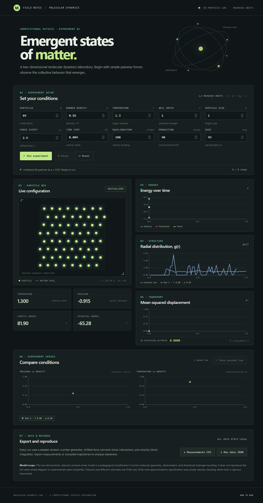

# Emergent States of Matter

An interactive molecular dynamics laboratory for exploring how simple pairwise forces produce collective behavior. Configure a two-dimensional particle system, watch it evolve, and compare the structural and thermodynamic observables it generates.

## Screenshots

**The complete lab** — controls, periodic particle box, energy history, radial distribution function, transport, and data export.



**Values For Different Simulations** the controls are specific values from a set number to set number but what is possible of the values will be done in the simulation.


## Get started

Requires Node.js 18 or newer. No third-party runtime packages are needed.

```powershell
npm.cmd start
```

Open <http://127.0.0.1:4173>, configure the experiment, and select **Run experiment**. In Command Prompt, you can use `npm start` instead.

For the complete setup and usage guide, see [HOW_TO_RUN.md](HOW_TO_RUN.md).

## Explore

- Configure particle count, number density, temperature, Lennard–Jones parameters, cutoff, timestep, equilibration, production duration, and random seed.
- Initialize particles on a jittered lattice and animate their motion in a square box with periodic boundary conditions.
- Equilibrate with velocity rescaling, then collect production measurements in an unthermostatted NVE run.
- Track kinetic, potential, and total energy; temperature; virial pressure; mean-squared displacement; and a two-dimensional diffusion estimate.
- Inspect the radial distribution function and save runs to compare structure, pressure, and temperature across conditions.
- Export sampled measurements as CSV or measurements, RDF, parameters, and trajectory frames as JSON.

## Model and numerical methods

The simulator uses Lennard–Jones reduced units, with particle mass, Boltzmann constant, and default energy and length scales set to one. It integrates Newton's equations with velocity-Verlet, applies the minimum-image convention to pair separations, and uses a **shifted-force Lennard–Jones cutoff** so the potential and force both approach zero continuously at the cutoff. The cutoff cannot exceed half the box length.

Temperature accounts for center-of-mass degrees of freedom, and pressure is estimated with the two-dimensional virial expression. The RDF uses ideal-gas normalization in circular two-dimensional shells and minimum-image distances. MSD uses unwrapped coordinates; the diffusion estimate is one quarter of a linear-fit slope over the latter half of recorded production samples.

The model is a finite-size classical simulation for learning and experimentation. It omits water's molecular geometry, electrostatics, and directional hydrogen bonding; it does **not** reproduce the full water phase diagram or experimental water properties. Pressure and transport estimates depend on system size and sampling, and simple velocity rescaling is not a rigorous canonical thermostat.

## Validate

```powershell
npm.cmd test
```

The automated tests check the shifted-force against a numerical derivative of the potential, cutoff continuity, minimum-image distances, reproducible initialization, observables, and improved microcanonical energy conservation with a smaller timestep.

## Project layout

| Path | Purpose |
| --- | --- |
| `src/md.js` | Seeded simulation engine, interaction model, integrator, measurements, RDF, and trajectory sampling |
| `src/app.js` | Browser controls, animation, plots, experiment comparisons, and data export |
| `tests/md.test.js` | Automated numerical and scientific validation |
| `server.js` | Dependency-free local static-file server |
| `HOW_TO_RUN.md` | Detailed setup, workflow, and model interpretation |
